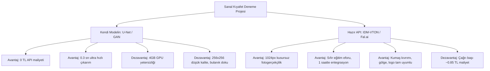

# 👔 Sanal Kıyafet Deneme (VTON): Hazır AI API'leri vs. Kendi Modelini Eğitmek

> **Özet:** Projeniz veya bitirme teziniz için model eğitilirken ucuz bir yapay zeka API'si (Replicate, Fal.ai) kullanmak; **saatler içinde jilet gibi fotogerçekçi çıktılar almanızı**, mobil uygulamanızı hemen test edilebilir hale getirmenizi ve donanım sınırlarına takılmadan projenizi tamamlamanızı sağlar.

---

## 1. Piyasadaki En Popüler ve En Ucuz VTON API'leri

Günümüzde sanal kıyafet denemede GAN mimarileri yerini büyük ölçüde **Diffusion (IDM-VTON, CatVTON, OOTDiffusion)** modellerine bırakmıştır. Bu modelleri kendi sunucunuzda çalıştırmak yerine API üzerinden saniye veya görsel başına çağırmak oldukça ucuzdur:

| Sağlayıcı / Model | Çözünürlük & Teknoloji | Görsel Başına Maliyet | Yanıt Süresi | Lisans & Kullanım |
| :--- | :--- | :--- | :--- | :--- |
| **Replicate (IDM-VTON)** | 1024x768 / Diffusion | **~$0.024 (yaklaşık 0.85 TL)** | 10 - 18 sn | Açık kaynak model, test/demo için ideal |
| **Fal.ai (CatVTON / VTON)** | 1024x768 / Hızlı Diffusion | **~$0.025 - $0.040 (0.90 - 1.40 TL)** | 3 - 6 sn | Çok hızlı, düşük gecikmeli, mobil dostu |
| **Segmind (IDM-VTON API)** | 1024x768 / Serverless | **~$0.020 - $0.030 (0.70 - 1.05 TL)** | 12 - 20 sn | Kullandığın GPU saniyesi kadar öde |
| **FASHN.ai** | 4K / Ticari VTON Suite | **~$0.075 - $0.150 (2.60 - 5.25 TL)** | 15 - 25 sn | E-ticaret kalitesinde, doku ve logo korumalı |

> [!TIP]
> **Tavsiye:** Başlangıç için **Fal.ai** veya **Replicate** üzerinden IDM-VTON kullanmak en ekonomik olanıdır. $5 bakiye yüklediğinizde **yaklaşık 200 adet deneme** yapabilirsiniz.

---

## 2. Kendi Modelini Eğitmek vs. Hazır API Kullanmak



### A. Artıları (API Kullanmanın Getirdiği Avantajlar)

1. **Fotogerçekçi Görsel Kalite (Gece ile Gündüz Farkı):**
   * Kendi eğittiğiniz model (256x256 U-Net/GAN) basit bir kıyafet transferi yaparken kenarlarda lekelenmeler, ten renginde kaymalar veya kumaş deseninde bozulmalar yaşayabilir.
   * IDM-VTON gibi Diffusion API'leri; gömleğin yakasını, katlanma çizgilerini, kumaşın dokusunu ve kullanıcının duruşundaki ışıklandırmayı **orijinal bir moda fotoğrafı çekimi gibi** entegre eder.
2. **Pose ve Segmentasyon Derdinin Olmaması:**
   * API'ler arka planda OpenPose, DensePose ve Human Parsing adımlarını otomatik olarak bulutta en gelişmiş modellerle çözer.
   * Bilgisayarınızdaki MediaPipe yolu, C++ çökmeleri veya maske bozulmalarıyla uğraşmak zorunda kalmazsınız.
3. **Donanım Maliyetini Sıfırlaması:**
   * Bilgisayarınızdaki 4 GB GTX 1650 Ti ekran kartı zorlanmaz; fan sesi, ısınma veya `CUDA Out of Memory` hataları tamamen biter.
4. **Hızlı MVP ve Demo Gösterimi:**
   * Mobil uygulamanız (`mobileApp`) veya web arayüzünüz hemen yarın **gerçek bir müşteriye veya jüriye sunulabilecek seviyede profesyonel çalışır**.

### B. Eksileri (API Kullanmanın Dezavantajları)

1. **İşlem Başına Maliyet (Ölçeklenme Sorunu):**
   * Ayda 100-500 test yaparken ayda $5 - $15 tutar (ihmal edilebilir).
   * Ancak uygulamanız piyasaya çıkıp günde 50.000 kullanıcıya ulaşırsa API masrafı günde $1.200+ tutabilir.
2. **Gecikme Süresi (Latency):**
   * Sizin hafif U-Net / GAN modeliniz tek bir görseli yerel GPU'da **0.2 - 0.5 saniyede** üretebilir.
   * Diffusion tabanlı API'lerin yanıt vermesi **5 ila 15 saniye** sürer (Kullanıcıya mobil uygulamada yükleniyor animasyonu göstermek gerekir).
3. **Veri Gizliliği (Privacy):**
   * Kullanıcının yüklediği fotoğraflar üçüncü taraf bir sunucuya (ABD / Avrupa veri merkezlerine) gider.
4. **İnternet Bağımlılığı:**
   * Sunucu çevrimdışı olduğunda veya internet yavaşladığında sistem durur.

---

## 3. Karşılaştırma Matrisi

| Kriter | Kendi Modelin (U-Net / GAN) | Hazır API (Fal.ai / Replicate) |
| :--- | :--- | :--- |
| **Görsel Çözünürlük** | 128x128 veya 256x256 | 768x1024 veya 4K Ultra HD |
| **Kumaş & Doku Kalitesi** | Sentetik, bazen bulanık | Kusursuz fotogerçekçi, logolar net |
| **Geliştirme Süresi** | Haftalar / Aylar (Eğitim + Ayar) | **1 Saat (Sadece API Key ve Request)** |
| **İşlem Süresi** | ~0.5 saniye (Çok Hızlı) | ~5 - 15 saniye (Diffusion gecikmesi) |
| **Başlangıç Maliyeti** | 0 TL (Elektrik ve Donanım hariç) | 5$ depozito (deneme kredisi) |
| **Büyük Ölçek Maliyeti (100k istek)**| Ucuz (Sabit GPU sunucu maliyeti) | Pahalı (~$2.400 / ay) |
| **Akademik Değer** | Yüksek (Model mimarisini sen yazdın) | Düşük (Sadece entegratörsün) |

---

## 4. Pratik Entegrasyon: Flask (`app.py`) İçinde Nasıl Görünür?

Uygulamanızdaki app.py içine hazır bir API eklemek sadece birkaç satırdır. Örneğin `fal-client` kullanarak:

```python
import fal_client

@app.route('/vton_api', methods=['POST'])
def vton_api():
    user_file = request.files["user_image"]
    clothes_file = request.files["clothing_image"]

    # 1. Resimleri geçici olarak kaydet veya base64'e çevir
    user_url = upload_or_b64(user_file)
    cloth_url = upload_or_b64(clothes_file)

    # 2. Fal.ai CatVTON veya IDM-VTON API çağrısı
    handler = fal_client.submit(
        "fal-ai/cat-vton",
        arguments={
            "human_image_url": user_url,
            "garment_image_url": cloth_url,
            "cloth_type": "upper"
        }
    )
    result = handler.get()
    output_image_url = result["image"]["url"]

    return jsonify({"result_url": output_image_url}), 200
```

---

## 5. Önerilen En Akıllı Strateji: "Hibrit Model" (Best of Both Worlds)

Eğer bu bir **bitirme tezi**, **akademik proje** veya bir **girişim prototipi** ise en profesyonel yaklaşım şudur:

1. **Jüri ve Demo İçin API Desteği (Showcase):**
   * Mobil uygulamanıza bir seçenek koyun:  
     `Mod Seçimi: [ Hızlı Yerel Model (GAN) | Ultra HD AI Modeli (Bulut API) ]`
   * Jüriniz veya kullanıcılar **Ultra HD** modunu seçtiğinde Replicate / Fal.ai çağrılır ve **göz alıcı, kusursuz sonuçlar** görür. Bu sayede projenin bitmiş hali herkesi büyüler.
2. **Tez ve Mühendislik Başarısı İçin Kendi Modeliniz:**
   * Google Colab'de başlattığınız GAN eğitimini tamamlayın.
   * Raporunuzda/tezinizde:
     > *"Düşük donanımlı cihazlarda gerçek zamanlı çalışabilmesi için 10 kanallı hafif bir TryOn-GAN modeli eğitilmiş; yüksek doğruluklu e-ticaret senaryoları için ise sunucusuz Diffusion VTON API entegrasyonu gerçekleştirilerek iki mimari kıyaslanmıştır."*
   * Bu yaklaşım size hem yazılım mühendisliği hem de yapay zeka modelleme açısından **en yüksek notu ve prestiji** kazandırır.
